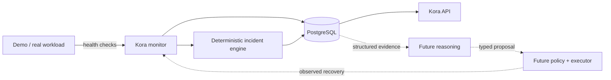

# Kora

**The reliability control plane for cloud infrastructure.**

Kora observes running systems, records deterministic telemetry, turns repeated failures into evidence-backed incidents, and verifies recovery from subsequent observations. The long-term system adds topology, change correlation, evidence-based AI reasoning, policy-controlled typed remediation and independent recovery verification. AI is never the monitoring source of truth or an unrestricted infrastructure executor.

## Milestone 1: what works
A Fastify demo workload exposes `/health`; its failure injection is disabled by default. Kora periodically checks a configured endpoint, persists observations in PostgreSQL, creates one incident after a configurable consecutive-failure threshold (default 3), retains structured evidence, exposes incidents/events/evidence over HTTP, and resolves only after a configurable consecutive-success threshold (default 3). Events use a versioned v1 runtime-validated envelope.

Not implemented: frontend, AI diagnosis, automatic remediation, policy evaluation, authentication/RBAC, RumptyCloud API/CLI integration, Kubernetes, multi-cloud or distributed monitoring.



## Quick start
Requires Node.js 22+, pnpm 10+, Docker Compose and PostgreSQL 17 for the supplied local environment.

```bash
pnpm install
cp .env.example .env
docker compose up -d postgres
# export .env values into your shell
pnpm db:migrate
pnpm --filter @kora/demo-service dev
# separate terminal
pnpm --filter @kora/api dev
```

For a controlled local incident set `DEMO_FAILURE_INJECTION_ENABLED=true` before starting the demo service, then follow `docs/runbooks/local-incident-demo.md`. Never enable it casually in production.

Common gates: `pnpm build`, `pnpm test`, `pnpm typecheck`, `pnpm lint`, `pnpm format:check`.

## Configuration
`.env.example` is the contract. `DATABASE_URL` must be PostgreSQL. Monitor URL, interval, timeout, failure threshold and recovery threshold are runtime validated. Times are UTC ISO timestamps and identifiers are UUIDs. Secrets belong in environment/secret management, never source control.

## API
`GET /health`, `/services`, `/services/:id`, `/incidents`, `/incidents/:id`, `/incidents/:id/events`, `/incidents/:id/evidence`. Responses are JSON with `data` for resource endpoints. Unknown resources return 404; invalid boundary inputs are rejected. Requests receive request IDs and logs are structured.

## Persistence and reliability semantics
PostgreSQL stores services, telemetry observations, incidents, evidence, versioned domain events and lightweight service dependencies. A partial unique index enforces one unresolved incident for a deduplication key. Current key: `<service-id>:health-check-unhealthy`. Evidence references concrete observations rather than generated prose. Recovery is a verified observation threshold, not an action/provider success code.

## Repository
- `apps/api` — API, monitor runtime, PostgreSQL access/migration.
- `apps/demo-service` — controlled workload.
- `services/incident-engine` — deterministic pure reliability rules.
- `packages/event-schema` — event/action contracts and runtime validation.
- `packages/topology` — lightweight dependency model.
- `integrations/rumptycloud` — documented provider seam; no fabricated client.
- `docs` — architecture, ADRs, security and runbooks.

## Security philosophy
Deterministic facts precede reasoning; cloud credentials never belong in an AI context; automatic arbitrary shell execution is out of scope; future actions are typed and policy-gated. Development failure controls fail closed. SQL values are parameterized. The current API has no authentication and therefore is not suitable for unrestricted public exposure. See `docs/security/threat-model.md`.

## RumptyCloud status
RumptyCloud is the first intended provider and the project workspace is named Kora. Milestone 1 deliberately does not invent Rumpty APIs, CLI commands or authentication. `docs/runbooks/first-rumpty-deployment.md` records what must be verified for Milestone 2.

## Roadmap
1. **Current:** deterministic local reliability loop.
2. Deploy Kora/demo/PostgreSQL on verified RumptyCloud primitives.
3. Real infrastructure telemetry and deployment correlation.
4. Live system graph.
5. Evidence-based AI reasoning.
6. Blast-radius/policy engine.
7. Human-approved typed remediation.
8. Rich verification and Chaos Lab.
9. Benchmarking/evaluation.
10. Console, polish, demo and technical article.

Architecture detail: `docs/architecture/overview.md`. Decisions: `docs/adr/`. Licensed under Apache-2.0.
