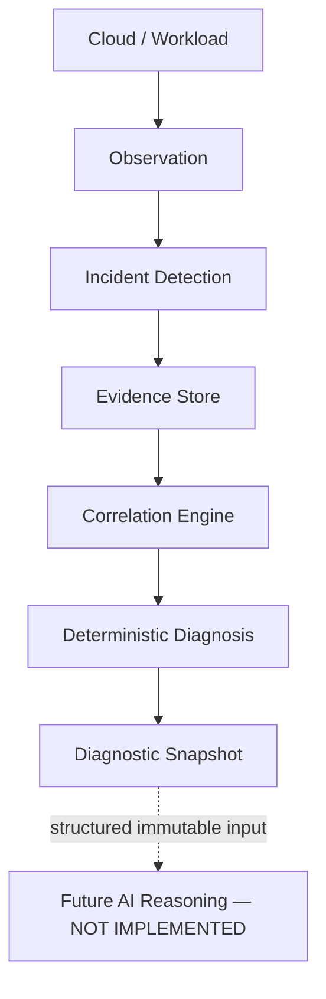

# Deterministic diagnosis

Milestone 3 adds **CORRELATE → DIAGNOSE** without generative AI or remediation. The diagnosis engine is pure: the same evidence, topology references and rules produce the same ordered findings and integrity hash.

## Epistemic boundary

Kora keeps four levels distinct:

- **Fact** — directly persisted observation or topology/provider state.
- **Inference** — a deterministic interpretation of facts, such as service unavailability.
- **Diagnosis** — a typed symptom-level finding supported by exact evidence IDs.
- **Hypothesis** — a possible underlying cause. Milestone 3 does not promote unsupported hypotheses into diagnosis.

An HTTP 503 can produce `SERVICE_HTTP_5XX`. It cannot produce “VM crashed” or “out of memory” without evidence for those conditions.

## Evidence and provenance

Diagnostic evidence is attributable to an incident, service, optional provider resource, source, type, observed time, ingestion time and provenance. Each item receives a deterministic SHA-256 content hash. Current diagnosis uses health-check evidence already persisted by Kora. Provider, log, metric and deployment evidence are not fabricated.

Secret-bearing provenance is redacted before hashing or snapshot persistence. Provider metadata remains allow-listed by the Milestone 2 boundary.

## Correlation rules

Correlation is exact, not fuzzy. Evidence is selected through the incident's persisted evidence relation and therefore the incident/service identity established by the deterministic incident engine. Resource context comes from the explicit service/resource binding. Ordering is `observedAt`, then evidence ID for equal timestamps. Dependency proximity never implies causality.

## Confidence

Confidence is finite and rule-based:

- `CONFIRMED` — direct authoritative evidence establishes the represented condition, currently used for verified recovery.
- `STRONGLY_SUPPORTED` — at least three consistent symptom observations support the finding.
- `SUPPORTED` — one or more direct observations support the symptom but do not establish an underlying cause.
- `INSUFFICIENT_EVIDENCE` — reserved for conclusions Kora cannot support; unsupported root causes remain `UNKNOWN` instead of receiving invented percentages.

## Root cause and contradictions

Root-cause state is `IDENTIFIED`, `SUSPECTED` or `UNKNOWN`. Milestone 3 currently returns `UNKNOWN` because collected health observations do not establish infrastructure root cause. `SUSPECTED` must not be used without supporting evidence.

Provider `RUNNING` plus failing health is preserved as `RESOURCE_RUNNING_SERVICE_UNHEALTHY`. Neither fact overwrites the other. Conflicting provider states are also preserved.

## Evidence gaps

The snapshot explicitly records missing evidence. With the current collection surface these include `NO_RESOURCE_METRICS`, `NO_APPLICATION_LOGS` and `NO_DEPLOYMENT_CONTEXT`; `NO_PROVIDER_STATUS` is added when no provider status is present.

## Snapshots and integrity

`diagnostic_snapshots` stores immutable JSON snapshots and SHA-256 hashes. Equivalent diagnostically relevant input is canonicalized with sorted object keys and deterministic evidence/finding ordering. The hash changes when relevant input changes. Snapshot rows reject updates at the database layer.

Evidence retrieval is capped deterministically (default 500 items). If the cap is reached, `truncated=true` and `totalEvidenceCount` exposes the loss explicitly rather than silently pretending the snapshot is complete.

## API

- `GET /incidents/:id/diagnosis` creates or reuses the deterministic snapshot for the current incident evidence.
- `GET /incidents/:id/snapshots` lists persisted snapshot identities and hashes.
- `GET /incidents/:id/snapshots/:snapshotId` retrieves a persisted snapshot.
- Existing incident, event, evidence and timeline endpoints remain available.

## Future AI boundary

Future AI may reason over an explicit snapshot, but it must not replace monitoring facts, mutate historical evidence, or directly execute infrastructure actions. Milestone 3 is read-only reasoning and adds no provider mutation, shell execution, LLM, chatbot or agent framework.
