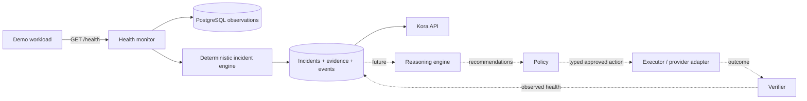

# Kora architecture

## Problem and principles

Kora is a reliability control plane for cloud infrastructure. It separates fact collection from interpretation and action: deterministic components collect observations and detect incidents; future AI reasons only over structured evidence; policy gates typed actions; executors act with constrained credentials; observed health verifies recovery.



## Current responsibilities

`apps/demo-service` supplies a real controllable health endpoint. `apps/api` owns HTTP API, PostgreSQL persistence and the Milestone 1 monitor runtime. `services/incident-engine` is deterministic, state-transition logic independent of I/O. `packages/event-schema` defines the v1 durable event envelope. `packages/topology` establishes lightweight dependency contracts. PostgreSQL is the system of record.

## Event and incident flow

Each check persists a structured observation and HealthCheckSucceeded/Failed event. Three failures by default create one incident. The deduplication key is `<service UUID>:health-check-unhealthy`; PostgreSQL also enforces one unresolved incident per key. Continued failures attach evidence to that incident. Three successes by default confirm recovery, persist recovery evidence, resolve the incident and record RecoveryVerified. Thresholds are configuration.

Lifecycle vocabulary is `DETECTED → INVESTIGATING → ACTION_PROPOSED → AWAITING_APPROVAL → REMEDIATING → VERIFYING → RESOLVED|FAILED`; Milestone 1 intentionally uses only DETECTED and RESOLVED. Severity is deliberately small: threshold detection is HIGH; twice-threshold sustained detection can be CRITICAL in domain logic. It is not a risk score.

Evidence is structured and references immutable observations: time, status, latency, timeout, reason/category and threshold count. It is not generated prose. This makes future diagnoses traceable.

## System graph direction

Topology currently models components and explicit `depends_on` relationships only. Future graph enrichment can add provider resources, instances and runtime edges without introducing graph algorithms prematurely.

## Provider and AI boundaries

Core packages do not import RumptyCloud code. Provider-specific behavior belongs in `integrations/rumptycloud`; no API is fabricated in Milestone 1. Future reasoning consumes incident evidence, topology, deployments and recent changes and returns a structured diagnosis: likely cause, confidence, evidence references, affected components, recommended typed action and risk notes. It receives neither unrestricted cloud credentials nor an arbitrary command execution primitive. If AI is unavailable, monitoring and deterministic incident detection continue.

Future remediation is `ProposedAction → Policy(DENY|REQUIRE_APPROVAL|ALLOW) → typed executor → observation window → RecoveryVerified|RecoveryFailed`. HTTP 200 from an action is never proof of recovery.

## Trust boundaries

Clients are untrusted at the API boundary. Health responses are untrusted telemetry. PostgreSQL is trusted durable state but may be unavailable. Future agents, reasoning providers and provider APIs are separate trust zones. Cloud credentials terminate at provider/executor boundaries, not reasoning.

## Failure behavior

Unreachable/DNS/timeout checks become failed observations with categories. Malformed boundary data is rejected by Zod. Event IDs are idempotency keys in PostgreSQL. Late/out-of-order event handling is not solved yet; timestamps are retained for future ordering rules. Each health check is persisted in one transaction (observation, health event, incident effects, evidence and their events); on PostgreSQL failure that check is rolled back, logged and not applied to in-memory state. On restart the unresolved incident and its full evidence are reloaded from PostgreSQL before the first check; pre-incident failure streaks restart at zero and recovery of a reloaded incident needs the full configured success count observed after startup. If incident creation conflicts with an existing active incident, the same observation is replayed once against the stored incident (see ADR-008). Future AI/provider outages must not stop deterministic detection. Half-completed remediation will require explicit action state and verification in later milestones.

## Current limitations

Single configured monitored service per API process; in-memory threshold counters; no authentication/RBAC; no AI, executor, policy implementation, provider API client, console or autonomous remediation. These are deliberate scope boundaries.

## Platform layer (added after the kernel)

```
Mission Control (apps/web) ──► Kora API (apps/api) ──► Kora Core (monitor, incidents, diagnosis, verification)
                                   │                          │
            Builder (packages/site-schema) + Publisher        ▼
                                   │               Reasoner (services/reasoner)  ── validated JSON only
                                   ▼                          ▼
                       Rumpty bucket / Kora-hosted   Policy (services/policy-engine) ─► DENY | REQUIRE_APPROVAL | ALLOW
                                                              ▼
                                            Typed executor ─► publisher/provider ─► observe again ─► RecoveryVerified | RecoveryFailed
```

Per-site monitors reuse the original `HealthMonitor`: each site is a `service` with its own durable incident state, bound to a provider resource identity. Change events are append-only and expose timing only; the diagnostic snapshot format is unchanged (hash-stable), and change context travels beside it into the Reasoner, the Owner view and Passport v2. The system graph is computed on demand from relationships Kora actually holds (workspace/resource/version/domain/forms) and propagates failures along documented directions.

Limits: single API node (in-memory rate limits, per-process monitors); Kora-hosted sites share the API's failure domain; no email, no password reset, no registrar purchase flow.
