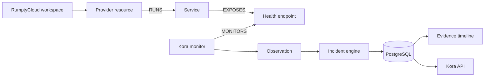

# Provider-aware observation

Milestone 2 extends Kora's deterministic reliability kernel with durable cloud resource context without making provider APIs a prerequisite for incident detection.

## Provider contract

The provider-neutral model defines durable resource identity, capability advertisement, normalized resources, and explicit topology relationships. Providers must not claim unsupported capabilities.

Kora distinguishes three layers:

1. **Observation** — facts such as HTTP 503, timeout, DNS failure, or provider-query failure.
2. **Inference** — deterministic conclusions justified by those facts, such as a service being unhealthy after the configured threshold.
3. **Diagnosis** — causal reasoning such as “the VM crashed”; this is not implemented in Milestone 2 and must not be inferred from an HTTP failure alone.

## Resource identity

Resource identity uses provider, provider account/workspace, region, resource type, and provider resource ID. Names are mutable display metadata.

## Capability model

The common vocabulary includes resource discovery/status, health observation, logs, metrics, deployment metadata, restart, redeploy, rollback, and scaling. The RumptyCloud adapter currently advertises only `HEALTH_OBSERVATION` because that is the only capability Kora implements against verified public behavior without inventing an undocumented API schema.

## Persistence

`provider_resources` stores normalized current resource metadata. `service_resource_bindings` records explicit service/resource relationships. Observations reference the resource row, preserving historical association even when mutable provider metadata later changes. Incident API responses resolve service and resource context through these durable links.

## Timeline

`GET /incidents/:id/timeline` deterministically merges incident-correlated domain events with persisted evidence observations and orders them chronologically. It contains facts and transitions, not generated narrative.

## Provider failure

A provider-control-plane failure is not evidence that a customer workload is down. Provider errors are normalized separately. Incident detection remains driven by workload observations. This preserves operation when a future provider API is unavailable.

## Security

Provider credentials are adapter-only secrets. The current adapter does not need a credential. Metadata is allow-listed, provider error text is redacted, and secrets must never enter events/evidence/API responses. Future credentialed provider calls must use least-privilege API keys from secret storage.
